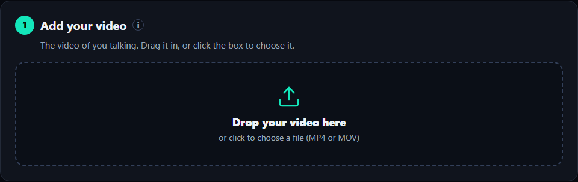
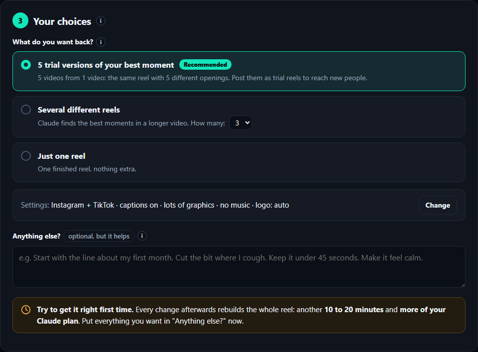
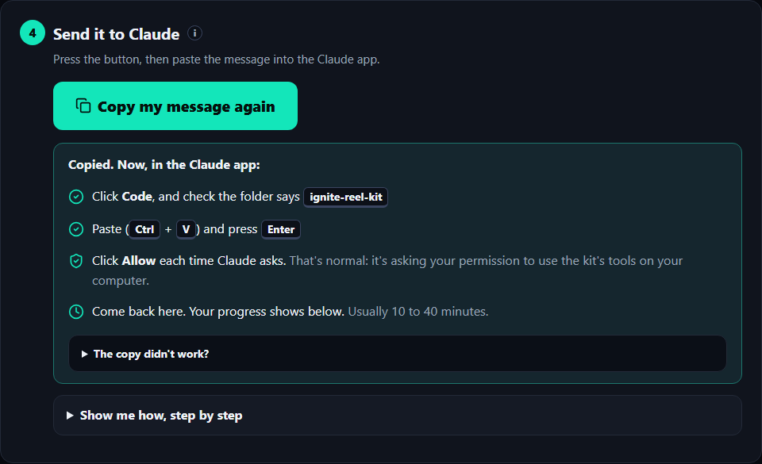
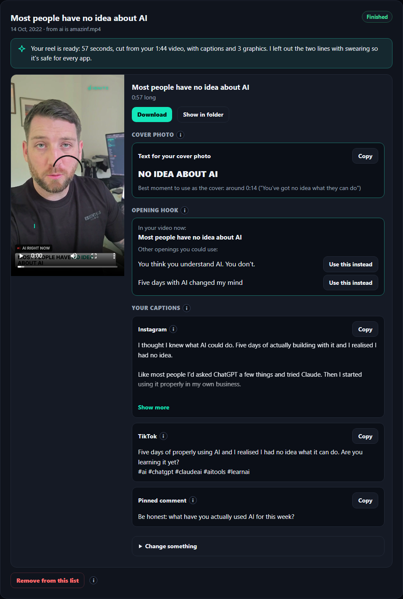

# Start here

The IGNITE Reel Kit turns a video of you talking into finished reels for Instagram, TikTok, Facebook and
YouTube Shorts, with captions, graphics and ready-written posts. It runs on your own computer, with your own
Claude account. You don't need to be technical: Claude does the work, you click **Allow**.

**Time:** about 30 minutes to set up (once), then about a minute per video plus Claude's editing time.

---

## What you need

- A **Mac or Windows computer** with about 5 GB free, plugged in.
- The **Claude app** (free download: [claude.com/download](https://claude.com/download)), signed in to **your
  own paid Claude plan** (Pro is fine). Not the website: the app.
- No GitHub account, no coding, nothing else.

---

## 1. Install it (once)

1. Open the **Claude app** and click **Code** at the top.
2. Copy this whole message, paste it into Claude's message box and press **Enter**:

> Please set up the IGNITE Reel Kit for me from https://github.com/ignitelee/ignite-reel-kit
> I'm new to this, so keep your messages short and simple, and run every step yourself: I'll just click Allow.
> If git isn't installed, install it first. If Windows can't find a tool you've just installed, refresh the
> PATH yourself instead of asking me to restart. Download the kit into my Documents folder (or update it if
> it's already there), then open `.claude/skills/reel-setup/SKILL.md` inside it and follow it step by step.
> If anything needs my password, tell me exactly where to type it, click by click.

3. **Click Allow** whenever Claude asks. That's normal: Claude asks your permission before it runs anything on
   your computer. If Windows asks "Do you want to allow this app to make changes?", click **Yes**.
4. On a Mac, Claude may ask you to type your Mac password once, in an app called Terminal. It tells you
   exactly where. Type it yourself (nothing shows as you type, that's normal). Never paste a password into
   the Claude chat.
5. At the end Claude asks for your **logo** and your **brand colour**, then opens **Reel Studio** (your
   dashboard) in the Claude app.

---

## 2. Make reels

Open the dashboard any time by saying **open my reel dashboard** to Claude.

**Step 1: add your video.** Drag in the video of you talking (filmed on your phone is perfect).

**Step 3: your choices.** The recommended settings are already picked: **5 trial versions** of your best
moment, so you get 5 videos out of 1. Write anything you want in **Anything else?**. The more detail now, the
fewer changes later (each change takes 10 to 20 minutes and uses more of your Claude plan).

**Step 4: send it to Claude.** Press **Copy my message for Claude**, go back to Claude (Code, folder
**ignite-reel-kit**), paste, press Enter, and click **Allow** when asked.

Then come back to the dashboard: the progress bar fills in while Claude works (usually 10 to 40 minutes).

---

## 3. Post them

Everything is on the **My reels** tab: the video with a **Download** button, the text for your cover photo,
your opening hook (with other openings you could use), and a ready-written caption for each app with a
**Copy** button.

- **Trial reels:** on Instagram, switch on **Trial** when you share. Trial reels are shown to people who
  don't follow you yet. Post one version a day and keep the one with the most views.
- **Cover photo:** when posting, tap "Edit cover" (Instagram) or "Select cover" (TikTok), pick the moment
  suggested, and add the cover text.
- **Pinned comment:** after posting, write it as a comment on your own video, press and hold it, tap **Pin**.

The kit never posts anything for you.

---

## If something goes wrong

- **Claude keeps asking to Allow:** normal. Click Allow.
- **Nothing is happening on the dashboard:** check the Claude app. It's probably waiting for you to click Allow.
- **The dashboard says it has stopped:** say **open my reel dashboard** to Claude.
- **Anything else:** take a screenshot of the Claude app (Windows: `Windows` + `Shift` + `S`; Mac:
  `Cmd` + `Shift` + `4`) and send it to whoever shared the kit with you.

The dashboard's **Help** tab answers the most common questions.
